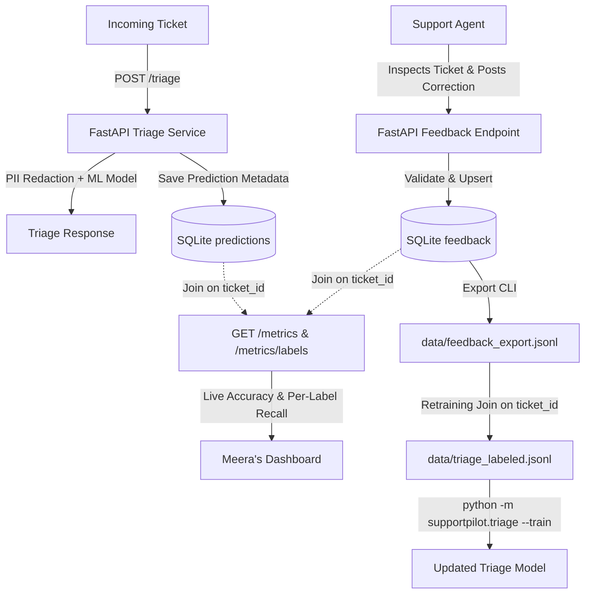

# SP-110: Feedback Loop (Agent Corrections)

## Overview

SupportPilot's feedback loop enables human agents to correct automated ticket triage predictions. Agent corrections provide:
1. **Live Accuracy Metrics**: Real-time evaluation of model performance against human ground truth.
2. **Retraining Dataset Exports**: High-confidence corrections formatted for incremental fine-tuning and model retraining.
3. **Zero-PII Privacy Guarantees**: Strict isolation preventing any ticket bodies, customer messages, or raw text from entering feedback storage.

---

## Data Flow



### End-to-End Stages
1. **Triage Ingestion (`POST /triage`)**: Redacts customer PII in memory, computes category prediction, and saves telemetry metadata (`ticket_id`, `predicted_label`, `confidence`, `model_version`, `created_at`) to the `predictions` table. Ticket bodies, customer text, and PII are never persisted.
2. **Agent Ground Truth Submission (`POST /feedback`)**: Human agents review tickets and submit corrections (`ticket_id`, `correct_label`, `agent_id`). Upserts update the record if a ticket is re-reviewed.
3. **Live Monitoring (`GET /metrics`, `GET /metrics/labels`)**: Evaluates real-time agreement between `predictions` and `feedback` via an inner join on `ticket_id`. Returns overall `live_accuracy` and category-level `recall`.
4. **Retraining Export (`python -m supportpilot.feedback export`)**: Queries feedback rows and writes pure `{ticket_id, correct_label}` JSONL lines atomically.
5. **Retraining Dataset Join (`join_feedback_for_retraining`)**: Combines export pairs with original tickets on `ticket_id`, replacing old labels with verified ground truth before triggering retraining.

---

## Architecture & Storage

The feedback subsystem uses an embedded SQLite database configured in Write-Ahead Logging (`WAL`) mode with `NORMAL` synchronous writes for high concurrency across async Uvicorn worker threads.

The database path is configured via the `FEEDBACK_DB_PATH` environment variable, defaulting to `data/feedback.db`.

> [!WARNING]
> **Render free-tier warning**: The SQLite file is wiped on every redeploy, so feedback is lost until we move to Postgres (Dev's note). Local container filesystems on Render's free tier are ephemeral (`FEEDBACK_DB_PATH`, defaulting to `data/feedback.db`), resetting database state upon restart or redeployment until migrated to Postgres.

### Database Schema

```sql
CREATE TABLE IF NOT EXISTS predictions (
    ticket_id TEXT PRIMARY KEY,
    predicted_label TEXT NOT NULL,
    confidence REAL NOT NULL,
    model_version TEXT NOT NULL,
    created_at TEXT NOT NULL
);

CREATE INDEX IF NOT EXISTS idx_predictions_predicted_label
ON predictions(predicted_label);

CREATE TABLE IF NOT EXISTS feedback (
    ticket_id TEXT PRIMARY KEY,
    correct_label TEXT NOT NULL,
    agent_id TEXT NOT NULL,
    created_at TEXT NOT NULL,
    FOREIGN KEY (ticket_id) REFERENCES predictions(ticket_id)
);

CREATE INDEX IF NOT EXISTS idx_feedback_correct_label
ON feedback(correct_label);
```

### Privacy & Zero-PII Guarantees
- **No Body / Subject Stored**: Neither `predictions` nor `feedback` contains body, subject, customer metadata, or raw text columns.
- **SQL Injection Prevention**: All queries use parameterized placeholders (`?`). F-strings and string interpolation in SQL statements are strictly prohibited.
- **Verification**: Verified via schema inspection, row value scans, and binary database file byte analysis.

---

## Design Decisions

### 1. Rohan's Decision: Re-Triage Prediction Upsert Policy

**Problem Statement:**  
When a ticket is re-triaged (e.g., ticket resubmitted or processed through multiple automated pipeline stages), the prediction row for that `ticket_id` is candidate for an upsert. However, if an agent has already submitted feedback for that ticket, overwriting the stored prediction causes downstream accuracy metrics and retraining pipelines to evaluate human feedback against a prediction the agent never saw.

**Decision & Behavior:**
- **No Feedback Yet**: Re-triaging an unreviewed ticket overwrites the prediction row with the latest prediction, confidence, model version, and timestamp.
- **Feedback Already Exists**: Re-triaging does **NOT** overwrite the stored prediction. The original prediction that the human agent evaluated is preserved in the database.

**SQL Implementation:**
```sql
INSERT INTO predictions (ticket_id, predicted_label, confidence, model_version, created_at)
VALUES (?, ?, ?, ?, ?)
ON CONFLICT(ticket_id) DO UPDATE SET
    predicted_label = excluded.predicted_label,
    confidence = excluded.confidence,
    model_version = excluded.model_version,
    created_at = excluded.created_at
WHERE NOT EXISTS (
    SELECT 1 FROM feedback WHERE feedback.ticket_id = predictions.ticket_id
);
```

### 2. Sana's Decision: Graceful Degradation on DB Write Failure in `/triage`

**Problem Statement:**  
If a database write error occurs during `/triage` (e.g., transient SQLite database lock or filesystem error), should `/triage` return HTTP 500 or answer the classification and log the error?

**Decision:**
- **Answer and Log**: Triage is the primary customer-facing product SLA; feedback recording is secondary operational telemetry.
- When `save_prediction()` raises an operational exception, `/triage` catches and logs the exception with full context and `ticket_id`, but returns `200 OK` with the triage classification response.

### 3. Database Access Path & Fail-Fast Initialization

- **Single Access Path**: `app.state.feedback_store` (`FeedbackStore`) is the sole database handle on FastAPI's application state. Legacy connection handles and aliases have been eliminated.
- **Fail Fast at Startup**: Lifespan verifies and initializes the database at application startup. If initialization fails, startup halts immediately with a `RuntimeError`.
- **Fail Fast in Endpoints**: If `app.state.feedback_store` is missing or `None` during request execution, endpoints raise `RuntimeError` rather than silently creating an unmanaged store.

---

## API Specifications

### `POST /feedback`
Submit or update human agent corrections for a triaged ticket.

- **Authentication**: Requires valid API key via `X-API-Key` header (same as `/triage`).
- **Rate Limiting**: Enforces the standard 60 req/min rolling window limit.
- **Identifier Constraints**: `ticket_id` and `agent_id` are normalized by stripping whitespace and enforced with a `max_length=64` limit (consistent with ingestion).

> [!NOTE]
> `agent_id` must be an opaque ID (e.g. `AG-102`, a code with no personal info), not an email or a name, because it’s logged.

**Request Body:**
```json
{
  "ticket_id": "T-10492",
  "correct_label": "delivery",
  "agent_id": "AG-102"
}
```

**Status Codes:**
- `200 OK`: Feedback saved or updated successfully.
  ```json
  {
    "ticket_id": "T-10492",
    "correct_label": "delivery",
    "predicted_label": "delivery",
    "agreed": true
  }
  ```
- `404 Not Found`: Ticket was never triaged (`Ticket 'T-10492' has not been triaged.`).
- `422 Unprocessable Entity`: Invalid `correct_label` (must be one of `billing`, `cancellation`, `delivery`, `order_status`, `refund`, `account`, `other`), or empty `ticket_id` / `agent_id`.
- `401 Unauthorized`: Missing or invalid API key.
- `429 Too Many Requests`: Rate limit exceeded.

**Upsert on Duplicate Feedback:**  
If an agent submits feedback for an already-reviewed ticket (or another agent corrects a prior label), the row is updated in place (`ON CONFLICT(ticket_id) DO UPDATE`). Each ticket has at most one row in `feedback`.

---

### `GET /metrics`
Aggregates live model accuracy alongside operational counters.

**Metric Fields Added (SP-110):**
- `feedback_total` (`int`): Total count of reviewed tickets.
- `live_accuracy` (`float | null`): Ratio of predictions where `predicted_label == correct_label`. Returns `null` when `feedback_total == 0`.

**Example Response:**
```json
{
  "requests_total": 150,
  "triage_total": 150,
  "errors_total": 0,
  "avg_latency_ms": 1.45,
  "needs_review_rate": 0.16,
  "rate_limited_total": 0,
  "feedback_total": 40,
  "live_accuracy": 0.875
}
```

---

### `GET /metrics/labels`
Per-category performance breakdown based on human agent corrections. Protected by API key authentication (`X-API-Key`) and rate limiting dependencies.

> [!NOTE]
> **Recall Semantics**: Because feedback records are grouped by human ground truth (`correct_label`), this metric represents per-class **Recall** ($\text{TP} \div (\text{TP} + \text{FN})$): "of all true tickets for this class, how many did the model predict correctly?". The metric field is named `recall`.

**Response Schema:**
Maps category labels (`delivery`, `billing`, `refund`, `cancellation`, `account`, `other`) to:
- `total` (`int`): Number of feedback items received for this true category.
- `agreed` (`int`): Number of predictions that matched agent correction.
- `recall` (`float | null`): `agreed / total`, or `null` if `total == 0`.

**Example Response:**
```json
{
  "delivery": {
    "total": 20,
    "agreed": 18,
    "recall": 0.9
  },
  "billing": {
    "total": 10,
    "agreed": 8,
    "recall": 0.8
  },
  "refund": {
    "total": 10,
    "agreed": 9,
    "recall": 0.9
  },
  "cancellation": {
    "total": 0,
    "agreed": 0,
    "recall": null
  },
  "account": {
    "total": 0,
    "agreed": 0,
    "recall": null
  },
  "other": {
    "total": 0,
    "agreed": 0,
    "recall": null
  }
}
```

---

## CLI Tool: Feedback Export

Export feedback pairs (`ticket_id` and `correct_label` only) to JSON Lines for model retraining:

```bash
python -m supportpilot.feedback export --output data/feedback_export.jsonl
```

**Output Format (`data/feedback_export.jsonl`):**
```json
{"ticket_id": "T-10492", "correct_label": "delivery"}
{"ticket_id": "T-10493", "correct_label": "refund"}
```

Exports are written atomically using a temporary file and renamed on completion to avoid partial writes.

---

## Retraining Join: Combining Feedback with Original & Pilot Tickets

### Retraining join: how to combine feedback_export.jsonl with the original redacted tickets by ticket_id

To retrain the triage classifier using human feedback corrections, combine the exported `data/feedback_export.jsonl` with the original tickets (`data/triage_labeled.jsonl`) and pilot tickets (`out_redacted/redacted.jsonl`) by `ticket_id`.

### Join Logic
1. **Fail-Fast Validation**: Verifies `feedback_export` and `original_dataset` exist immediately. Missing input files raise `FileNotFoundError` rather than silently skipping corrections.
2. **Load Corrections**: Parses `feedback_export.jsonl` into a dictionary mapping `ticket_id -> correct_label`.
3. **Relabel Original Tickets**: Scans `data/triage_labeled.jsonl`. For tickets with agent feedback, updates `label = correct_label` (`matched`). Tickets without feedback retain their original label.
4. **Append Pilot Tickets**: Scans helpdesk pilot tickets (`out_redacted/redacted.jsonl`). For pilot tickets reviewed by agents, appends them as new training rows `{"ticket_id": tid, "body": body, "label": correct_label}` (`appended`). This ensures retraining learns from real production data.
5. **Report Unmatched Rows**: Unmatched feedback rows (feedback entries with no ticket text in either dataset) are counted (`unmatched`) and reported so operators know what was omitted.
6. **Zero PII Introduced**: Because `feedback_export.jsonl` contains only `ticket_id` and `correct_label`, the join preserves the existing PII redaction of both datasets.

### Retraining Join Function (`supportpilot.feedback.join_feedback_for_retraining`)

```python
from pathlib import Path
from supportpilot.feedback import join_feedback_for_retraining

report = join_feedback_for_retraining(
    original_dataset=Path("data/triage_labeled.jsonl"),
    feedback_export=Path("data/feedback_export.jsonl"),
    redacted_tickets=Path("out_redacted/redacted.jsonl"),
    output_dataset=Path("data/triage_retrain.jsonl"),
)

print(
    f"Retraining dataset ready: {report.matched} matched, "
    f"{report.appended} appended, {report.unmatched} unmatched."
)
```

### CLI Command (`join`)
You can also run the join directly via the CLI:
```bash
python -m supportpilot.feedback join \
  --feedback data/feedback_export.jsonl \
  --original data/triage_labeled.jsonl \
  --redacted out_redacted/redacted.jsonl \
  --output data/triage_retrain.jsonl
```

### Triggering Model Retraining
After joining the dataset, retrain the classifier:
```bash
python -m supportpilot.triage --train
```
> [!TIP]
> **Rohan's Retraining Guideline**: *"If live_accuracy drops below 80%, we retrain."*
