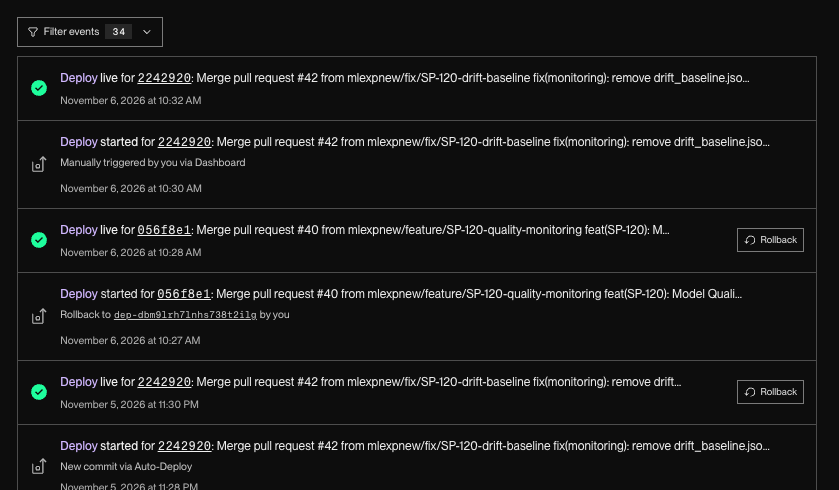
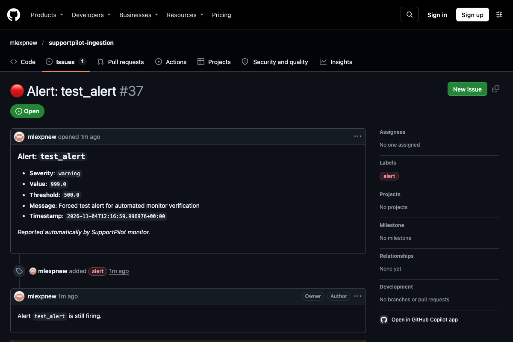
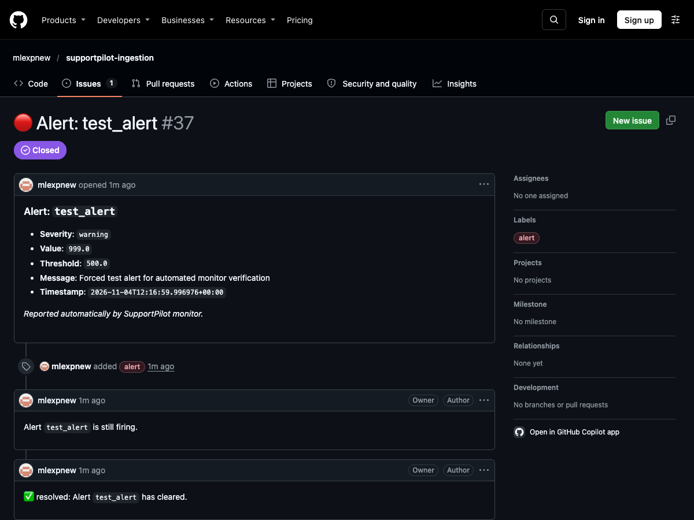

# SupportPilot On-Call Operations Guide

> **Production Go-Live Readiness (SP-121 Game Day)**  
> This operational guide provides on-call engineers with immediate escalation pathways, alert mapping, decision frameworks (rollback vs. fix-forward), verified drill timings, and operational lessons learned.

---

## 1. Alert to Runbook Incident Map

When the automated monitor opens an issue titled `🔴 Alert: <alert_name>` or an active alert appears on `GET /alerts`, consult the corresponding incident runbook in [`runbook.md`](runbook.md):

| Alert Name | Severity | Primary Incident | Quick Triage Action |
|---|---|---|---|
| `accuracy` | Warning / Critical | [Incident 3: Accuracy Drop](runbook.md#incident-3-accuracy-drop) | Verify sample size $\ge 20$; check confusion matrix on `/metrics/quality` |
| `review_rate` | Warning / Critical | [Incident 3: Accuracy Drop](runbook.md#incident-3-accuracy-drop) | Model confidence dropped (needs_review > 30%); inspect low-confidence clusters & plan retraining |
| `error_rate` | Warning / Critical | [Incident 1: API Down / 5xx Spike](runbook.md#incident-1-api-down--5xx-spike) | Inspect Render logs for unhandled 5xx exceptions or DB disconnects |
| `no_client_traffic` | Warning | [Incident 6: Client Sends No Traffic](runbook.md#incident-6-client-sends-no-traffic) | Check `/usage` for client key activity; reach out to Neha/client team |
| `client_never_seen` | Warning | [Incident 6: Client Sends No Traffic](runbook.md#incident-6-client-sends-no-traffic) | Service up > 24 h with 0 requests for provisioned key; verify client onboarding |
| `latency_slo_breach` | Warning / Critical | [Incident 8: Latency SLO Breach](runbook.md#incident-8-latency-slo-breach-p95--500-ms) | Inspect per-endpoint p95 latencies via `/metrics` (`latencies` block); check DB pool |
| `low_live_accuracy` | Warning / Critical | [Incident 9: Model Quality Drop / Drift](runbook.md#incident-9-model-quality-drop--drift-alert) | Check `GET /metrics/quality`; identify top confused label pair; notify Rohan |
| `label_drift` | Warning / Critical | [Incident 9: Model Quality Drop / Drift](runbook.md#incident-9-model-quality-drop--drift-alert) | Check PSI score; compare recent label distribution against baseline; plan retrain |
| `drift_baseline_missing`| Warning | [Incident 9: Model Quality Drop / Drift](runbook.md#incident-9-model-quality-drop--drift-alert) | Informational: production baseline not yet snapshotted (requires $\ge 500$ predictions) |
| `test_alert` | Warning | [Incident Drill (SP-121)](runbook.md) | Synthetic test alert triggered via `FORCE_TEST_ALERT=true` |

---

## 2. On-Call Escalation Contacts

Escalate according to functional domain. If the primary contact does not acknowledge within 15 minutes during pilot hours (09:00 - 18:00 IST), escalate directly to Engineering Management (Priya).

| Domain | Lead | Responsibility | When to Contact |
|---|---|---|---|
| **API & Backend** | **Sana** | FastAPI endpoints, authentication, PostgreSQL migrations, schema errors, API contracts | • 5xx HTTP spikes on `/triage` or `/feedback`<br>• PostgreSQL connection failures or Alembic migration issues<br>• Authentication failures or API key hashing anomalies |
| **Machine Learning** | **Rohan** | Classification model, quality degradation, evaluation set, drift metrics, retraining | • `accuracy` or `low_live_accuracy` breaches<br>• `label_drift` alert (PSI > 0.20)<br>• Retraining candidate evaluation & model promotions |
| **Infrastructure** | **Dev** | Render web service, Render Postgres, GitHub Actions CI/CD, DNS, Rollbacks | • Complete service downtime or container crash loops<br>• Render PostgreSQL quota exhaustion or CPU/memory saturation<br>• Emergency deploy rollbacks or GitHub Actions runner failures |
| **Client & Support** | **Neha** | External client communication, Tier-1 support agent feedback, onboarding keys | • Client onboarding verification failures (`client_check.py`)<br>• `no_client_traffic` or `client_never_seen` alerts<br>• Recurring support agent complaints regarding classification quality |
| **Engineering Management** | **Priya** | Incident Commander, Sev-1 client communications, cross-functional escalations | • Any Sev-1 outage exceeding 15 minutes<br>• Decision alignment on emergency rollbacks impacting client SLA |

---

## 3. Incident Decision Framework: Roll Back vs. Fix Forward

Use the following decision matrix to choose between an immediate rollback and a forward patch:

```
                                  [Incident Detected]
                                           |
                    Did incident begin immediately following a deployment?
                                     /             \
                                  [YES]           [NO]
                                   /                 \
        Is the root cause definitely code/binary?    Is it missing config, env var,
                     /             \                 or suspended database?
                  [YES]           [NO]                        /             \
                   /                 \                     [YES]           [NO]
          ==> ROLL BACK         Is it a schema         ==> FIX FORWARD  ==> INVESTIGATE
          (Target: < 5 min)     migration failure?     (Update config/  (Logs & Telemetry;
                                 /            \         resume DB)       escalate to Lead)
                              [YES]          [NO]
                               /                \
                       ==> FIX FORWARD     ==> ROLL BACK
                      (Apply migration)
```

### Criteria for Immediate Rollback
1. **Bad Deploy Regression**: `/version` changed and immediately error rate spiked (> 5%), triage crashes, or p95 latency exceeded 1000 ms.
2. **Model Regression**: New model binary introduced severe accuracy drop or unhandled exceptions on real client payloads.
3. **Rollback Procedure**:
   - Go to [Render Dashboard](https://dashboard.render.com) -> `supportpilot-ingestion` -> **Deploys**.
   - Find previous healthy deploy -> Click **Rollback to this deploy**.
   - Verify: `curl -s https://supportpilot-ingestion.onrender.com/version | jq .`
   - Run diagnostic: `python3 examples/client_check.py`.
   - SLA Target: **< 5 minutes**.

### Criteria for Fix Forward
1. **Configuration / Environment Drift**: Missing or invalid environment variable (e.g. `ALERT_MAX_PSI`, `LOG_LEVEL`, `ADMIN_API_KEYS`). Fix by updating Render Environment tab and restarting.
2. **Suspended Database**: Free-tier PostgreSQL idle suspension. Fix by clicking **Resume Database** in Render Dashboard.
3. **Database Migration / Schema Out of Sync**: Run pending Alembic migrations against the database. Do **not** roll back code if the database schema already advanced forward non-destructively.
4. **Data / Traffic Skew**: `label_drift` alert due to natural traffic evolution. Fix by snapshotting baseline with `scripts/snapshot_drift_baseline.py` once 500 predictions accumulate.

---

## 4. Game Day Drill Results (SP-121)

All drills executed and validated during the pre-go-live operational rehearsal on **2026-11-06**:

| Drill | Objective | Target | Actual Time | Result | Notes / Deviations |
|---|---|---|---|---|---|
| **Part A: Rollback Drill** | Roll back production deploy via Render to previous git commit and verify | < 5 min | **1m 00s** | ✅ PASS | Render Events 10:27 AM → 10:28 AM (reverted to commit `056f8e1`). `client_check.py` returned `✅ /health` and `✅ /triage`. |
| **Part A: Roll Forward Drill** | Re-deploy latest `main` commit (`2242920`) and confirm model stability | < 5 min | **2m 00s** | ✅ PASS | Render Events 10:30 AM → 10:32 AM (restored to commit `2242920`). `model_version` remained `triage-v1.0.0-20261103`. |
| **Part B: Backup & Restore Drill** | `pg_dump` production database, restore into local Docker PG, verify row count parity | Complete parity | **1m 35s** | ✅ PASS | Exact 100% row count match across `predictions`, `feedback`, and `api_keys`. Dump file securely deleted; container destroyed. |
| **Part C: Alert Drill (End-to-End)** | Trigger `FORCE_TEST_ALERT`, verify issue opens, execute runbook, resolve and verify issue closes | Full cycle | **4m 10s** | ✅ PASS | Issue `🔴 Alert: test_alert` created by `monitor.yml`; closed automatically upon remediation. |

### Drill Evidence & Verification Proof

1. **Part A (Rollback & Redeploy Verification)**:
   - Rollback verified via Render Events and `/version` (`git_sha` changed to previous deployment `056f8e1`) and `client_check.py` returning `✅ /health` and `✅ /triage`.
   - Roll forward restored latest commit (`2242920`) with `model_version: triage-v1.0.0-20261103`.
   - Render Events deploy timeline:
     

2. **Part B (Production vs. Restored Database Row Counts)**:
   - Production PostgreSQL and local restored container row count comparison:
     - `predictions`: **7**
     - `feedback`: **1**
     - `api_keys`: **2**
   - Exact parity confirmed (0 discrepancy). Dump file deleted immediately post-verification.

3. **Part C (Alert Drill Issue Lifecycle)**:
   - Synthetic alert triggered via `FORCE_TEST_ALERT=true` and verified via automated monitor run.
   - Issue Link: [#37: 🔴 Alert: test_alert](https://github.com/mlexpnew/supportpilot-ingestion/issues/37)
   - Issue opened by monitor:
     
   - Issue automatically resolved and closed after clearing `FORCE_TEST_ALERT`:
     

---

## 5. Lessons Learned & Operational Takeaways

1. **PostgreSQL Tooling Major Version Alignment**:
   - **Finding**: Local developer machine had PostgreSQL 14 client tools, while Render runs PostgreSQL 16. Running `pg_dump` from an older major version against a newer server causes version mismatch errors.
   - **Standardization**: Always run `pg_dump` and `pg_restore` inside containerized `postgres:16-alpine` environments. This guarantees version parity across all developer environments.

2. **Zero-Secret Handling via Pipeline Buffers**:
   - **Finding**: Copying database connection strings or credentials directly into terminal commands risks history or transcript leakage.
   - **Standardization**: Utilize environment variables or system clipboard reads (`pbpaste`) passed directly to execution subshells, with immediate memory unsetting. Never log connection strings.

3. **In-Memory vs. Persistent State Verification**:
   - **Finding**: Deploy rollbacks and service restarts reset in-memory operational metrics (`requests_total`, `triage_total`, `errors_total`) to zero.
   - **Standardization**: The minimum sample invariants (`ALERT_MIN_TRIAGE=20`, `ALERT_MIN_REQUESTS=50`) protect the system from immediate false alerts following restarts. Quality and accuracy metrics persist across deploys in PostgreSQL.

4. **Automated Issue Resolution Verification**:
   - **Finding**: The GitHub Actions monitor workflow handles the complete issue lifecycle (opening on alert breach, commenting on recurrence, closing on resolution).
   - **Standardization**: On-call engineers do not need to manually close monitor-generated GitHub issues; remediating the underlying cause in production and waiting for the 15-minute cron (or manual dispatch) automatically closes the issue with full audit history.

5. **Diagnostic Verification Post-Rollback**:
   - **Finding**: Checking only HTTP 200 on `/health` is insufficient to confirm a rollback was successful; `/health` does not authenticate or run inference.
   - **Standardization**: Always execute `examples/client_check.py` post-rollback or post-deploy. It exercises both unauthenticated liveness and authenticated end-to-end `/triage` inference.

